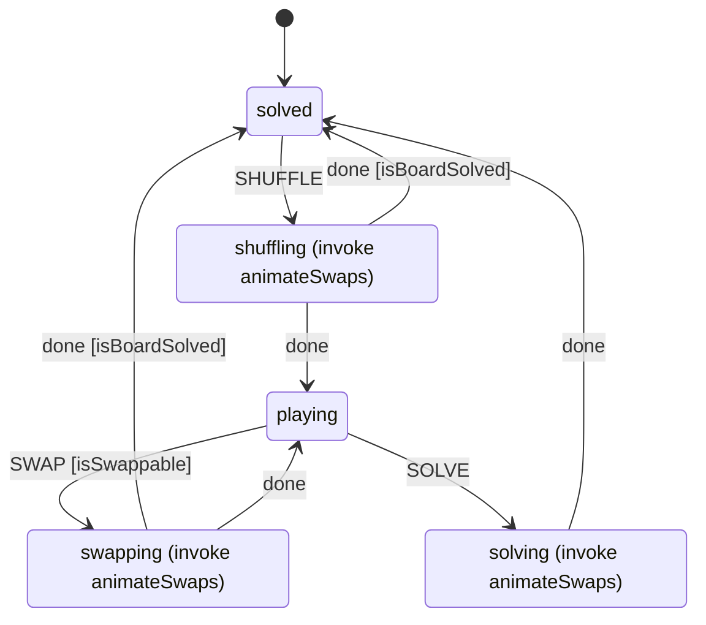

# 15-puzzle

[Play](https://grancalavera.github.io/15-puzzle/)

## Game state

The game state is an [XState](https://stately.ai/docs/xstate) machine, `gameMachine` in [`src/state.ts`](src/state.ts). The diagram below is generated from that machine definition.

- `SHUFFLE`, `SWAP` and `SOLVE` are the events the UI sends.
- `done` means the invoked `animateSwaps` actor has finished animating the tiles. The view supplies this actor through `gameMachine.provide`.
- When a transition has guarded and unguarded versions, the machine tries the guarded one first. For example, a shuffle can land on a solved board by chance, and then the machine goes back to `solved`.
